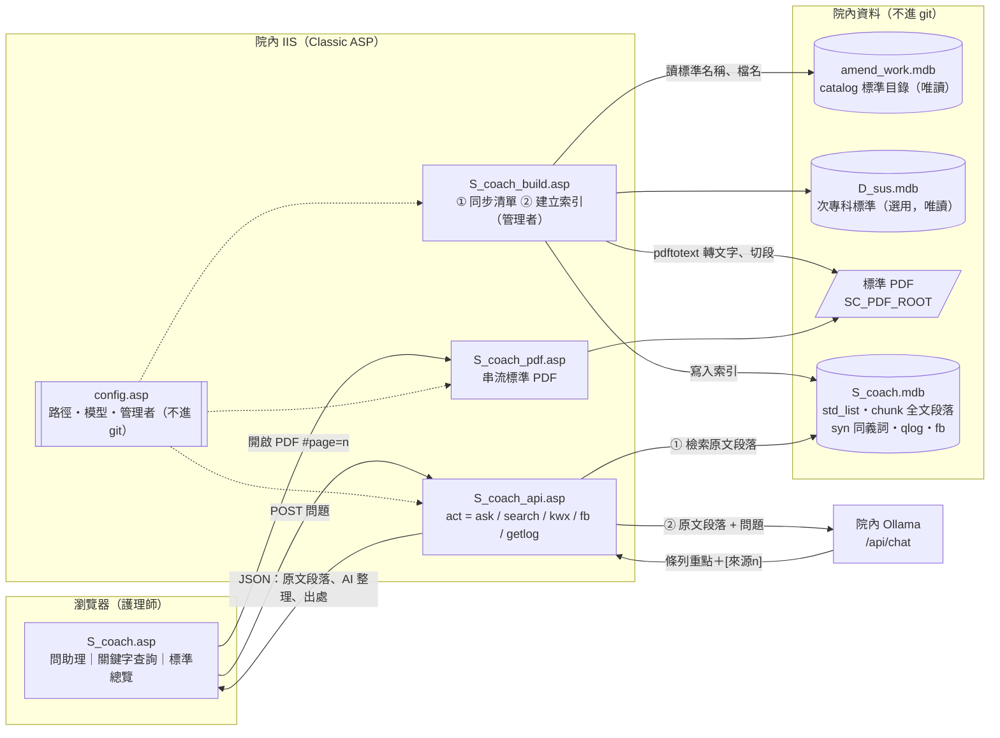

# 護理標準查詢助理（Nursing Standards Assistant）

> 學姊不在，也有人可以問：新進護理師 SOP 智慧助理

讓新進護理師用自己的話詢問護理技術問題，系統先從院內護理標準 PDF 找出相關原文段落，再交給院內自架的 AI（Ollama）**只依原文**整理重點，並在每句標註出處（標準編號＋頁碼）。標準裡沒有寫的內容，助理不會自己回答。

本 repo 有兩個版本：

| | 正式版 `src/asp/` | 示範版 `demo/` |
|---|---|---|
| 執行環境 | 醫院內網 IIS + Classic ASP | 任何瀏覽器，不需伺服器 |
| 標準資料 | `amend_work.mdb` + 院內標準 PDF（不在 repo 內） | `demo/sample_standards.json`（2 份**虛構**的護理技術） |
| 檢索 | `S_coach_api.asp` 檢索 `S_coach.mdb` 全文索引、同義詞庫 | `demo/mock_api.js` 簡化版關鍵詞＋同義詞比對 |
| AI 整理 | 院內 Ollama（模型由 `config.asp` 設定） | 規則模擬：直接摘錄原文句子並加 `[來源n]`，**不是語言模型** |
| 開啟 PDF | `S_coach_pdf.asp` 串流院內 PDF，跳到指定頁 | 在頁面中跳出視窗，顯示 JSON 裡該頁的文字 |
| 登入 / 權限 | 內網 `worknb` cookie；管理者名單在 `config.asp` | 無，固定顯示「示範使用者」 |
| 提問紀錄、回饋、審核答案 | 寫入 `S_coach.mdb`（qlog、fb） | 不保存；回饋按鈕只回傳成功 |
| 管理頁面 | 索引管理、提問紀錄、回饋審核、同義詞、AI 連線測試、初始化 | 無 |
| 介面 | `S_coach.asp` + `S_coach_layout.asp` + `css/S_coach.css` | 同一份 CSS；HTML 與前端程式由正式版轉出 |

> 院內資料庫、標準 PDF、員工與提問紀錄**都不在 repo 內，也不可上傳**。

---

## 系統架構（正式版）



**查詢時的流程（`act=ask`）**

1. 前端先送 `ai=0`：API 把問題拆成關鍵詞（含同義詞、縮寫，例：foley ＝ 導尿），判斷問題意圖（注意事項／步驟／頻率…），在 `S_coach.mdb` 的 `chunk` 表找出最相關的段落（最多 `SC_TOPK` 段、每份標準最多 `SC_PER_STD` 段），**馬上**把原文段落顯示給使用者。
2. 完全沒有命中 → 回覆「標準中找不到」；命中率低於 `SC_MIN_COVER` → 只列出「可能相關」的原文段落。這兩種情況都**不呼叫 AI 整理**。（AI 啟用時，前端會先請 AI 把口語／縮寫改寫成標準用詞（`act=kwx`）再找一次，有比較好才採用。）
3. 命中時前端再送 `ai=1`：API 把同樣的原文段落與問題交給 Ollama，系統提示詞要求「只能用摘錄內容、每句標出處、數值一字不差」。
4. 前端把 `[來源n]` 轉成可點的出處（標準編號＋頁碼），並檢查 AI 回答中的每個數字是否出現在引用的原文中，找不到的數值標 ⚠。
5. 問題、命中標準、AI 回答寫入 `qlog`，使用者可在「我的提問紀錄」重看；回饋寫入 `fb`，由臨床教師在「回饋與審核」處理。

**索引建立（管理者，`S_coach_build.asp`）**：① 從 `amend_work.mdb` 的 `catalog` 同步標準清單、PDF 檔名與教學影片（停用的標準自動移除）→ ② 用 `pdftotext` 把 PDF 轉成文字、依頁切成約 `SC_CHUNK_LEN` 字的段落，寫入 `chunk`。查詢時只讀索引，不直接讀 `amend_work.mdb`。

## 檔案結構

```
src/asp/
  config.sample.asp     設定範本（可 commit）→ 複製成 config.asp 後修改
  config.asp            實際設定（.gitignore，不 commit）
  S_coach_conn.asp      共用函式（連線、登入檢查、JSON 跳脫）；引入 config.asp
  S_coach_types.asp     標準類別（CP 護理技術、CR 護理常規…）與資料表建立
  S_coach_layout.asp    共用版面（Header、Sidebar）
  S_coach.asp           前台：問助理／關鍵字查詢／標準總覽
  S_coach_api.asp       查詢 API（檢索、呼叫 AI、紀錄）
  S_coach_pdf.asp       開啟標準 PDF
  S_coach_my.asp        我的提問紀錄
  S_coach_build.asp     索引管理（管理者）
  S_coach_log.asp       提問紀錄統計（管理者）
  S_coach_review.asp    回饋與審核答案（管理者）
  S_coach_syn.asp       同義詞管理（管理者）
  S_coach_syn_dict.txt  臨床縮寫同義詞庫（可匯入）
  S_coach_aitest.asp    AI 連線與速度測試（管理者）
  S_coach_setup.asp     系統初始化（管理者）
  css/S_coach.css       共用樣式（正式版與示範版共用）
demo/
  index.html            示範版頁面（由正式版版面轉成靜態 HTML）
  app.js                前端程式（複製自 S_coach.asp，差異處標 [DEMO]）
  mock_api.js           本機模擬 API：讀 JSON、檢索、模擬 AI
  sample_standards.json 2 份虛構的護理技術範例
  demo.css              示範版額外樣式（PDF 視窗）
tests/
  questions.md          測試題庫範本
```

## 正式版安裝（院內）

1. 把 `src/asp/` 放到內網 IIS 站台的子資料夾（需啟用 Classic ASP；本系統所有檔案為 UTF-8）。
2. 複製 `config.sample.asp` 為 `config.asp`，填入：`SC_CATALOG`（amend_work.mdb）、`SC_PDF_ROOT`、`SC_PDFTOTEXT`、`SC_ADMINS`、`SC_ORG_NAME`；要用 AI 時設 `SC_AI_ENABLED = True`、`SC_AI_URL`、`SC_MODEL`。
3. 以管理者身分開 `S_coach_setup.asp` 執行初始化，再到「索引管理」依序按 ① 同步、② 建立索引。
4. 用「AI 連線測試」（`S_coach_aitest.asp`）確認 Ollama 可連線與回答速度。

## 示範版使用方式

- **最簡單**：直接用瀏覽器開啟 `demo/index.html`。因瀏覽器安全限制，以 `file://` 開啟時無法自動讀取 JSON，頁面上方會出現按鈕，選擇 `demo/sample_standards.json` 即可開始使用。
- **免選檔**：在 repo 根目錄執行 `python -m http.server 8000`，開 `http://localhost:8000/demo/`。（要從根目錄啟動，因為示範版會讀 `../src/asp/css/S_coach.css`。）
- 可試：「濕洗手要洗多久？」「有氣管內管的病人多久做一次口腔護理？」「PICC 換藥」（示範資料中沒有 → 應顯示找不到）。
- 想增加示範標準：在 `sample_standards.json` 的 `standards` 加一筆，格式同現有兩筆（`pages[].sections[]` 每個元素是一段原文，第一行為段落標題）。**只能放虛構或已公開的內容**。
- 正式版前端（`S_coach.asp` 的 `<script>`）修改後，請把同樣修改同步到 `demo/app.js`（差異處都標有 `[DEMO]`）。

## 測試

測試題庫見 [tests/questions.md](tests/questions.md)：每題記錄問題、預期答案重點、應引用的標準編號與頁碼，正式版與示範版各一區。

## 注意

- 本系統只做「查詢護理標準」，不提供個別病人的診斷、用藥或醫療決策；實際執行請以最新版標準與醫囑為準。
- 示範版的兩份標準是為測試而撰寫的虛構內容，不可作為臨床依據。
