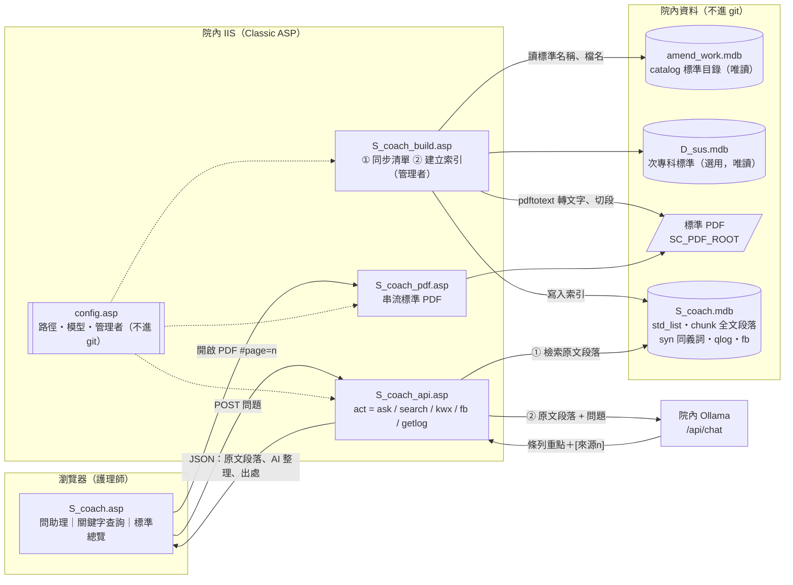

# 護理標準查詢助理（Nursing Standards Assistant）

> 學姊不在，也有人可以問：新進護理師 SOP 智慧助理

讓新進護理師用自己的話詢問護理技術問題，系統先從院內護理標準 PDF 找出相關原文段落，再交給院內自架的 AI（Ollama）**只依原文**整理重點，並在每句標註出處（標準編號＋頁碼）。標準裡沒有寫的內容，助理不會自己回答。

**示範版線上試用：<https://nurse-sop-assistant.vercel.app/>**（虛構資料，不需安裝）

本 repo 有兩個版本：

| | 正式版 `src/asp/` | 示範版 `demo/` |
|---|---|---|
| 執行環境 | 醫院內網 IIS + Classic ASP | 任何瀏覽器，不需伺服器 |
| 標準資料 | `amend_work.mdb` + 院內標準 PDF（不在 repo 內） | `demo/sample_standards.json`（4 份**虛構**的護理技術） |
| 檢索 | `S_coach_api.asp` 檢索 `S_coach.mdb` 全文索引、同義詞庫 | `demo/mock_api.js` 簡化版關鍵詞＋同義詞比對 |
| AI 整理 | 院內 Ollama（模型由 `config.asp` 設定） | 規則模擬：直接摘錄原文句子並加 `[來源n]`，**不是語言模型** |
| 開啟 PDF | `S_coach_pdf.asp` 串流院內 PDF，跳到指定頁 | 在頁面中跳出視窗，顯示 JSON 裡該頁的文字 |
| 登入 / 權限 | 內網 `worknb` cookie；管理者名單在 `config.asp` | 無，固定顯示「示範使用者」 |
| 我的提問紀錄 | 寫入 `S_coach.mdb` 的 qlog，依員工代號區分 | 存在使用者自己瀏覽器的 localStorage（最多 50 筆，不上傳，可清除） |
| 回饋、審核答案 | 寫入 `S_coach.mdb`（fb），臨床教師審核 | 不保存；回饋按鈕只回傳成功 |
| 語音提問／朗讀 | （尚未提供） | Web Speech API：說完自動送出；AI 回答可朗讀、可設定自動朗讀 |
| 拍照查標準 | （規劃：上傳院內 ASP，由 Ollama 視覺模型辨識） | 瀏覽器內 CLIP 圖片分類，照片不上傳，結果帶入問題由使用者確認 |
| 管理頁面 | 索引管理、提問紀錄、回饋審核、同義詞、AI 連線測試、初始化 | 無 |
| 介面 | `S_coach.asp` + `S_coach_layout.asp` + `css/S_coach.css` | 同一份 CSS 的複本（`demo/css/S_coach.css`）；HTML 與前端程式由正式版轉出 |

> 院內資料庫、標準 PDF、員工與提問紀錄**都不在 repo 內，也不可上傳**。

---

## 系統架構（正式版）



**查詢時的流程（`act=ask`）**

1. 前端先送 `ai=0`：API 把問題拆成關鍵詞（含同義詞、縮寫，例：foley ＝ 導尿），判斷問題意圖（注意事項／步驟／頻率…），在 `S_coach.mdb` 的 `chunk` 表找出最相關的段落（最多 `SC_TOPK` 段、每份標準最多 `SC_PER_STD` 段），**馬上**把原文段落顯示給使用者。
2. 完全沒有命中 → 回覆「標準中找不到」；命中率低於 `SC_MIN_COVER` → 只列出「可能相關」的原文段落。這兩種情況都**不呼叫 AI 整理**。（AI 啟用時，前端會先請 AI 把口語／縮寫改寫成標準用詞（`act=kwx`）再找一次，有比較好才採用。）
3. 命中時前端再送 `ai=1`：API 把同樣的原文段落與問題交給 Ollama，系統提示詞要求「只能用摘錄內容、每句標出處、數值一字不差」。
4. 前端把 `[來源n]` 轉成可點的出處（標準編號＋頁碼），並檢查 AI 回答中的每個數字是否出現在引用的原文中，找不到的數值標 ⚠。
5. 問題、命中標準、AI 回答寫入 `qlog`，使用者可在「我的提問紀錄」重看；回饋寫入 `fb`，由臨床教師在「回饋與審核」處理。

**索引建立（管理者，`S_coach_build.asp`）**：① 從 `amend_work.mdb` 的 `catalog` 同步標準清單、PDF 檔名與教學影片（停用的標準自動移除）→ ② 用 `pdftotext` 把 PDF 轉成文字、依頁切成約 `SC_CHUNK_LEN` 字的段落，寫入 `chunk`。查詢時只讀索引，不直接讀 `amend_work.mdb`。

## 檔案結構

```
src/asp/
  config.sample.asp     設定範本（可 commit）→ 複製成 config.asp 後修改
  config.asp            實際設定（.gitignore，不 commit）
  S_coach_conn.asp      共用函式（連線、登入檢查、JSON 跳脫）；引入 config.asp
  S_coach_types.asp     標準類別（CP 護理技術、CR 護理常規…）與資料表建立
  S_coach_layout.asp    共用版面（Header、Sidebar）
  S_coach.asp           前台：問助理／關鍵字查詢／標準總覽
  S_coach_api.asp       查詢 API（檢索、呼叫 AI、紀錄）
  S_coach_pdf.asp       開啟標準 PDF
  S_coach_my.asp        我的提問紀錄
  S_coach_build.asp     索引管理（管理者）
  S_coach_log.asp       提問紀錄統計（管理者）
  S_coach_review.asp    回饋與審核答案（管理者）
  S_coach_syn.asp       同義詞管理（管理者）
  S_coach_syn_dict.txt  臨床縮寫同義詞庫（可匯入）
  S_coach_aitest.asp    AI 連線與速度測試（管理者）
  S_coach_setup.asp     系統初始化（管理者）
  css/S_coach.css       共用樣式（正式版與示範版共用）
demo/
  index.html            示範版頁面（由正式版版面轉成靜態 HTML）
  app.js                前端程式（複製自 S_coach.asp，差異處標 [DEMO]）
  mock_api.js           本機模擬 API：讀 JSON、檢索、模擬 AI、寫入提問紀錄
  multimodal.js         語音提問、朗讀回答、拍照查標準（recognizeImage）
  history_store.js      提問紀錄的 localStorage 讀寫（全部包 try/catch）
  my.html, my.js        我的提問紀錄（比照 S_coach_my.asp）
  sample_standards.json 4 份虛構的護理技術範例＋拍照辨識用的英文描述（clip_labels）
  demo.css              示範版額外樣式（PDF 視窗、語音與拍照）
  css/S_coach.css       正式版樣式的複本（讓 demo/ 可單獨部署）
tests/
  questions.md          測試題庫範本
```

## 正式版安裝（院內）

1. 把 `src/asp/` 放到內網 IIS 站台的子資料夾（需啟用 Classic ASP；本系統所有檔案為 UTF-8）。
2. 複製 `config.sample.asp` 為 `config.asp`，填入：`SC_CATALOG`（amend_work.mdb）、`SC_PDF_ROOT`、`SC_PDFTOTEXT`、`SC_ADMINS`、`SC_ORG_NAME`；要用 AI 時設 `SC_AI_ENABLED = True`、`SC_AI_URL`、`SC_MODEL`。
3. 以管理者身分開 `S_coach_setup.asp` 執行初始化，再到「索引管理」依序按 ① 同步、② 建立索引。
4. 用「AI 連線測試」（`S_coach_aitest.asp`）確認 Ollama 可連線與回答速度。

## 示範版使用方式

- **線上版**：<https://nurse-sop-assistant.vercel.app/>（語音、拍照功能都可以直接使用）。
- **本機開檔**：直接用瀏覽器開啟 `demo/index.html`。因瀏覽器安全限制，以 `file://` 開啟時無法自動讀取 JSON，頁面上方會出現按鈕，選擇 `demo/sample_standards.json` 即可開始使用。
- **免選檔**：在 `demo/` 資料夾內執行 `python -m http.server 8000`，開 `http://localhost:8000/`。
- **部署（Vercel 等靜態主機）**：目前部署在 <https://nurse-sop-assistant.vercel.app/>，Root Directory 設為 `demo`，push 到 `main` 後自動更新。`demo/` 內的檔案不引用資料夾外的任何檔案，可單獨部署。
- `demo/css/S_coach.css` 是正式版 `src/asp/css/S_coach.css` 的**複本**；改了正式版樣式後請再複製一次：`cp src/asp/css/S_coach.css demo/css/S_coach.css`。
- 可試：「濕洗手要洗多久？」「有氣管內管的病人多久做一次口腔護理？」「幫浦出現阻塞警報怎麼辦？」「PICC 換藥」（示範資料中沒有 → 應顯示找不到）。
- 「我的提問紀錄」（`my.html`）：每次提問或關鍵字查詢都存一筆到**這個瀏覽器**的 localStorage，可重看完整回答、可清除；不會上傳。
- 想增加示範標準：在 `sample_standards.json` 的 `standards` 加一筆，格式同現有資料（`pages[].sections[]` 每個元素是一段原文，第一行為段落標題；`clip_labels` 放 4～6 句英文圖片描述）。**只能放虛構或已公開的內容**。
- 正式版前端（`S_coach.asp` 的 `<script>`）修改後，請把同樣修改同步到 `demo/app.js`（差異處都標有 `[DEMO]`）。

## 示範版：語音與拍照

兩個功能都在 `demo/multimodal.js`，只操作「問助理」的提問列，不修改 `app.js`。

### 語音提問＋朗讀回答

| 功能 | 使用方式 | 技術 |
|---|---|---|
| 語音提問 | 按輸入框左邊的 🎤，按鈕變紅閃動時說出問題；停頓後自動填入並送出。錄音中再按一次可停止 | Web Speech API `SpeechRecognition`，`lang = zh-TW` |
| 朗讀回答 | 每則 AI 回答右上角「🔊 朗讀」，再按一次停止；朗讀時略過出處（CP902 p.2）、標準編號與符號 | `speechSynthesis`，優先選 zh-TW 語音，語速 0.95 |
| 自動朗讀 | 提問列下方「回答自動朗讀」開關，設定存在 localStorage（`sc_demo_autoread`） | 讀寫包 try/catch，無法使用時只是不記住 |

- 語音辨識只支援 **Chrome、Edge**（Safari 部分支援）；Firefox 會隱藏麥克風並提示「請改用 Chrome 或 Edge」。
- 麥克風需要 **https 或 localhost**；Vercel 與 `python -m http.server` 都可以，直接用 `file://` 開可能無法使用。
- ⚠ Chrome／Edge 的語音辨識會把**聲音送到 Google／Microsoft 的雲端**辨識。示範版只用虛構資料所以可以使用；正式版若要語音輸入，應改用院內語音辨識服務。朗讀（speechSynthesis）使用作業系統內建語音，不需上傳。

### 拍照查標準

1. 按輸入框左邊的 📷，拍照（手機）或選擇圖片，畫面顯示縮圖。
2. 瀏覽器內用 CLIP 模型對每份標準的英文描述（`sample_standards.json` 的 `clip_labels`，每份 5～6 句）做 zero-shot 分類，同一份標準的描述機率加總 = 該標準的信心，顯示前 3 名。
3. 最高分的標準名稱自動帶入問題，例如「這張照片相關的是【輸液幫浦使用】，請問操作重點？」，**由使用者確認或修改後再送出**。
4. 最高信心低於 25%，或「與護理無關」的描述（`clip_other_labels`：人臉、文件、食物、動物…）機率更高時，顯示「看不太出來，請換一張或直接打字提問」，不硬猜。

| 項目 | 內容 |
|---|---|
| 函式庫 | [transformers.js](https://github.com/huggingface/transformers.js) `@huggingface/transformers@3.8.1`，由 cdn.jsdelivr.net 載入 |
| 模型 | `Xenova/clip-vit-base-patch32`（`zero-shot-image-classification`，`dtype: q8`，WebAssembly 執行） |
| 下載 | 第一次使用時從 Hugging Face 下載約 **150MB**，顯示下載進度；之後使用瀏覽器快取 |
| 隱私 | **照片只在瀏覽器內處理，不會上傳**；提問列旁提醒「請勿拍攝病人臉部、手圈或病歷」 |
| 正式版 | `recognizeImage(file)` 是獨立函式；正式版改為把圖片上傳到院內 ASP，由院內 Ollama 視覺模型辨識，照片不出醫院 |

實測（7 張公開照片）：輸液幫浦 94%、牙刷 99%、洗手 95%、手背留置針 52%（第二名輸液幫浦 46%）都正確；貓、只有洗手台的房間判定「看不太出來」。**已知限制**：立式乾洗手機曾被誤認為輸液幫浦（點滴架外型相近），所以辨識結果只帶入問題、不自動送出。

## 測試

測試題庫見 [tests/questions.md](tests/questions.md)：每題記錄問題、預期答案重點、應引用的標準編號與頁碼，正式版與示範版各一區。

## 注意

- 本系統只做「查詢護理標準」，不提供個別病人的診斷、用藥或醫療決策；實際執行請以最新版標準與醫囑為準。
- 示範版的四份標準是為測試而撰寫的虛構內容，不可作為臨床依據。
